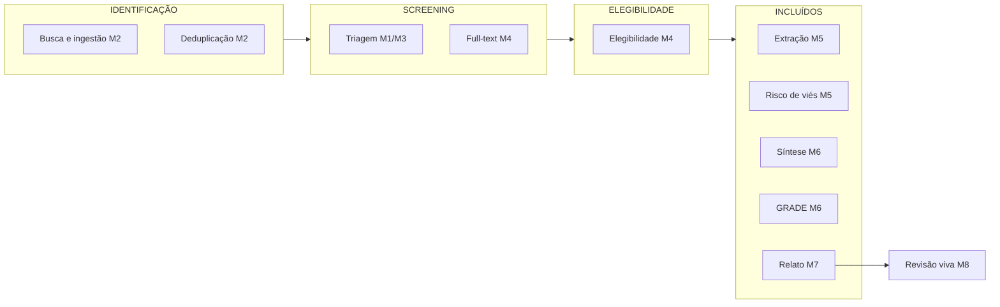
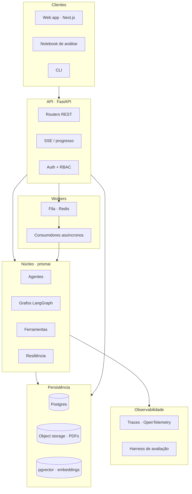
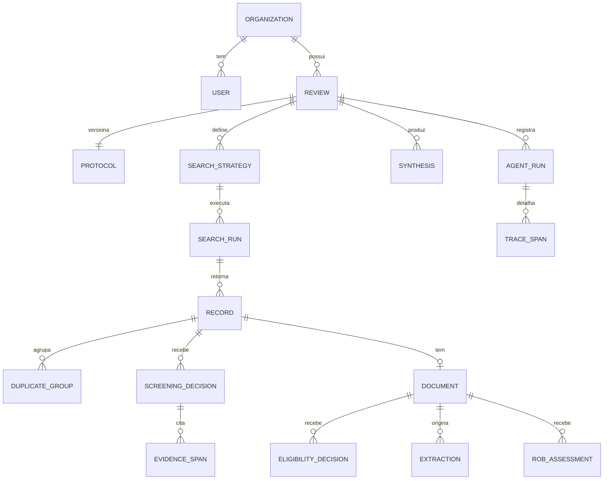
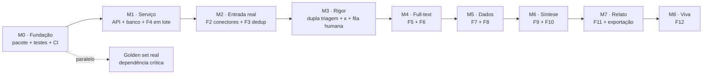

# Plano Master — Copiloto PRISMA

**Do screening acadêmico ao produto completo de revisão sistemática**

Autor: Thiago Nobre Mascarenhas
Origem: INF-0093 (UNICAMP) — entregáveis E1 a E4
Status: documento vivo · versão 11 · outubro de 2026

---

## 1. Onde estamos

O curso entregou a triagem de título e abstract dentro de um notebook. O pacote `prismai`
já cobre o fluxo da busca ao relato, com fila, banco e revisão como objeto. O que o desenho
abaixo marca com o milestone é núcleo fechado no código. Fora do desenho fica a F0: o
protocolo persiste, uma linha por revisão, sem histórico e sem exportação PROSPERO.



A estratégia de busca booleana por base (F1) não está nesse mapa: o M2 executa a query que
o revisor escreve, e não gera descritores controlados.

### 1.1 Ativos reaproveitáveis

O que já existe e sobrevive à migração, com pouca ou nenhuma reescrita:

| Ativo | Onde está hoje | Destino |
|---|---|---|
| `ScreeningResult` (Pydantic) | célula 5 do E4 | `core/models.py` — contrato público da API |
| `RespostaV4` (envelope de degradação) | célula 10 | `core/envelope.py` — padrão para **todas** as fases |
| Grafo `Coletor → Triador → Auditor` | célula 8 | `graphs/screening.py` |
| Skills com divulgação progressiva | célula 7 | `agents/skills/` — arquivos `.md` versionados |
| `localizar_trecho_literal` | célula 6 | `tools/literal.py` — base de toda auditoria de evidência |
| `avaliar_suficiencia` | célula 6 | `tools/sufficiency.py` |
| `buscar_arxiv` | célula 6 | `connectors/arxiv.py` — primeiro de N conectores |
| Camada de robustez (retry, timeout, degradação, validação, step limit) | célula 10 | `agents/resilience.py` — decoradores reutilizáveis |
| Harness de avaliação (N execuções, Wilson, faixa min-máx) | células 16-22 | `eval/harness.py` — vira suíte de regressão em CI |
| Pesos de erro + pares mínimos | células 26+ | `eval/ethics.py` — gate de release |
| Trace JSONL | `traces_v4.jsonl` | `obs/tracing.py` — vira tabela e OpenTelemetry |

### 1.2 Dívidas conhecidas que o produto precisa pagar

1. **Corpus real.** `eval/golden/casos.yaml` continua o conjunto sintético do curso (T01–T12 e T15). O aceite da F4 — recall ≥ 0,98 em ≥ 200 registros rotulados por humano — não foi medido. É a subida deste plano: sem esse corpus, todo número de aceite daqui é hipótese.
2. **Protocolo sem histórico.** A tabela `protocols` persiste e é editável, com `review_id` único. A versão nova substitui a anterior. O que falta é histórico, não tirar um dict do código.
3. **Auditor no mesmo modelo por padrão.** `model_auditor` é opcional e cai em `None`, então o Auditor reusa o LLM do Triador. O encaixe de diversidade existe; o padrão não o usa. Erros correlacionados continuam o caso comum.

Pagas na rodada alinhada ao E4: casamento parcial deixa de ser âncora verificada; suficiência é julgamento do LLM e a lista de marcadores fica como pista (1/6 no held-out); Coletor é etapa de fluxo, não agente.

---

## 2. Visão de produto

> Um copiloto que acompanha a revisão sistemática do protocolo ao manuscrito,
> em que **cada decisão automatizada é rastreável até um trecho literal da fonte**
> e **todo ponto de risco interrompe o fluxo de forma explícita, à espera de um humano**.

Três princípios não negociáveis, herdados direto do curso:

- **Fidelidade sobre fluência.** Nenhuma afirmação sem trecho literal localizável na fonte.
- **Assimetria de erro.** Falso negativo pesa 5, falso positivo pesa 2. O sistema otimiza recall.
- **Degradação que se anuncia.** Uma resposta parcial nunca se disfarça de resposta completa.

**Não-objetivos permanentes:** substituir o julgamento do revisor, gerar conclusão científica
sem supervisão, submeter manuscrito automaticamente.

---

## 3. Fases funcionais

Cada fase abaixo tem: objetivo, entrada/saída, agentes, ferramentas, o modo de falha que
mais dói, e o critério de aceite. A numeração segue o fluxo PRISMA, não a ordem de
implementação (essa está na seção 8).

---

### F0 — Protocolo e registro da revisão *(M1 persiste o protocolo; histórico e PROSPERO em aberto)*

**Objetivo.** Transformar uma pergunta de pesquisa em um protocolo formal, versionado e
exportável no formato PROSPERO.

**Entrada.** Pergunta em linguagem natural, área, restrições do pesquisador.
**Saída.** `Protocolo` persistido: PICO estruturado, critérios de inclusão/exclusão numerados,
desenhos aceitos, janela temporal, idiomas, bases-alvo, plano de síntese.

**Agentes.**
- *Formalizador PICO* — decompõe a pergunta em P, I, C, O e propõe critérios.
- *Crítico de protocolo* — procura ambiguidade, sobreposição e critério não operacionalizável.
  Reaproveita o padrão do Auditor: quem propõe não é quem valida.

**Ferramentas.** Vocabulários controlados (MeSH, Emtree), busca de protocolos análogos no
PROSPERO para calibrar granularidade.

**Modo de falha que mais dói.** Critério ambíguo. Se "desempenho acadêmico" não estiver
operacionalizado, toda a triagem herda a ambiguidade e nenhuma métrica adiante faz sentido.
É a falha que se propaga por todas as fases seguintes.

**Contenção.** O Crítico bloqueia o avanço enquanto houver critério sem teste de decisão
explícito. O protocolo só fica `ativo` após confirmação humana — ponto de parada obrigatório.

**Aceite.** Dado um protocolo, dois revisores humanos independentes classificam 20 registros-
sonda com concordância ≥ 0,8 (Cohen's κ). Se não houver acordo entre humanos, o critério
está ambíguo e o gargalo não é o sistema.

---

### F1 — Estratégia de busca *(M2 executa a query do revisor; a estratégia booleana gerada por base não fechou)*

**Objetivo.** Converter o protocolo em queries booleanas específicas por base, com sinônimos,
truncamentos e descritores controlados.

**Entrada.** `Protocolo` ativo.
**Saída.** Conjunto de `SearchStrategy`, uma por base, com a string exata, data de execução e
contagem retornada — os três campos que o PRISMA exige reportar.

**Agentes.**
- *Construtor de query* — expande cada bloco PICO em sinônimos e descritores.
- *Testador de sensibilidade* — valida a query contra um conjunto-semente de artigos que
  **sabidamente devem ser encontrados**. Se a query perde um semente, ela é cega.

**Ferramentas.** Tradutores de sintaxe por base (PubMed ≠ Scopus ≠ Web of Science ≠ arXiv),
consulta MeSH, contador de resultados.

**Modo de falha que mais dói.** Query restritiva demais. Perde estudos antes mesmo da triagem,
e nenhuma fase seguinte consegue recuperar o que nunca entrou.

**Contenção.** Teste de sensibilidade com sementes obrigatório antes de liberar a query.
Meta: recall de 100% no conjunto-semente. Abaixo disso, a query não é aprovada.

**Aceite.** 100% dos artigos-semente recuperados em cada base configurada.

---

### F2 — Execução da busca e ingestão *(núcleo fechado no M2)*

**Objetivo.** Executar as queries, paginar resultados, normalizar registros heterogêneos num
esquema único e registrar a proveniência de cada um.

**Entrada.** `SearchStrategy[]`.
**Saída.** `Record[]` normalizados com `source`, `source_id`, `doi`, `retrieved_at`, `raw_payload`.

**Conectores** (generalização do atual `buscar_arxiv`):

| Conector | Acesso | Prioridade |
|---|---|---|
| arXiv | API pública | já existe |
| OpenAlex | API pública, 250M+ obras | alta — melhor cobertura gratuita |
| Crossref | API pública | alta — resolução de DOI |
| PubMed / E-utilities | API pública com chave | alta — indispensável em saúde |
| Semantic Scholar | API com chave | média |
| Scopus / Web of Science | licença institucional | baixa — depende de contrato |
| Upload RIS/BibTeX/CSV | arquivo | **alta** — caminho de escape universal |

**Modo de falha que mais dói.** Ingestão parcial silenciosa. A base devolve 400 de 1.200
por rate limit e o sistema segue como se fossem 1.200. O PRISMA exige a contagem correta.

**Contenção.** O envelope `RespostaV4` sobe um nível: cada ingestão carrega
`esperado` vs `obtido`. Divergência bloqueia o avanço e exige decisão humana.

**Aceite.** Contagem reconciliada por base, com diferença explicada ou bloqueada.

---

### F3 — Deduplicação *(núcleo fechado no M2)*

**Objetivo.** Identificar o mesmo estudo aparecendo em múltiplas bases, com formatações
diferentes, e consolidar mantendo rastreabilidade das origens.

**Entrada.** `Record[]` brutos.
**Saída.** `Record[]` únicos + `DuplicateGroup[]` auditáveis.

**Abordagem em cascata** — do barato e determinístico ao caro e probabilístico:

1. DOI idêntico após normalização → duplicata certa, sem LLM.
2. Título normalizado + ano + primeiro autor → duplicata quase certa, sem LLM.
3. Similaridade de título (Levenshtein/Jaro-Winkler > 0,92) → candidata.
4. Embedding de título + abstract, cosseno > 0,95 → candidata.
5. **Só as candidatas** vão para um agente LLM de desempate, com os dois registros lado a lado.

**Modo de falha que mais dói.** Deduplicação agressiva demais. Fundir dois estudos distintos
do mesmo grupo de pesquisa (ex.: piloto e estudo principal) remove evidência real.

**Contenção.** Assimetria explícita: na dúvida, **não funde**. Duplicata não detectada custa
uma triagem extra; fusão indevida custa um estudo perdido. Toda fusão fica revertível e o
grupo de duplicatas é exibível.

**Aceite.** Em corpus rotulado, recall de duplicatas ≥ 0,95 **e** precisão ≥ 0,99. A precisão
é o número que importa — é ela que protege contra o erro grave.

---

### F4 — Triagem de título e abstract *(núcleo fechado no M1/M3; aceite em corpus real em aberto)*

**Objetivo.** Para cada registro, decidir `include` / `exclude` / `uncertain` com motivo
alinhado ao PICO e evidência literal.

**Estado atual.** Workflow determinístico com dois agentes (Triador e Auditor) e uma etapa
de coleta, sem chamada de modelo. Protocolo vem do banco. Lote, retomada, dupla triagem,
kappa e parada estatística já estão no serviço. No golden set sintético de 11 casos a
versão final acertou 11/11 em 3 execuções. Metade do ganho da v3 era regra de prompt, e a
heurística de suficiência por lista não generaliza (1/6 no held-out). O julgamento que o
Triador consome é do LLM; a lista fica como pista.

**O que falta:**

- Medir o aceite abaixo num corpus real rotulado por humano.
- Usar modelo distinto no Auditor por padrão. Hoje `model_auditor` é opcional e, omitido, o Auditor repete o modelo do Triador. A dupla triagem não fecha essa dívida: ela compara dois triadores, não troca o modelo de quem audita.

**Modo de falha que mais dói.** Falso negativo — já mapeado, peso 5.

**Aceite.** Recall ≥ 0,98 contra dupla triagem humana em corpus real de ≥ 200 registros.
Abaixo disso o sistema não pode operar sem revisão completa.

---

### F5 — Recuperação de full-text *(núcleo fechado no M4)*

**Objetivo.** Obter o PDF de cada registro incluído na triagem, registrando os que não foram
recuperados e o motivo — contagem que entra no diagrama PRISMA.

**Entrada.** `Record[]` com decisão `include`.
**Saída.** `Document[]` com PDF em object storage, texto extraído e estrutura de seções.

**Cascata de acesso.** Unpaywall → repositório institucional → PMC → arXiv → editor via DOI →
solicitação manual ao usuário.

**Ferramentas.** Extração de layout (GROBID ou similar) para separar seções, tabelas e
referências. Não basta texto corrido: a extração da F7 precisa saber o que é Método e o que
é Resultado.

**Modo de falha que mais dói.** PDF digitalizado sem camada de texto. O OCR erra números, e um
número errado contamina a meta-análise inteira.

**Contenção.** Detector de confiança de OCR. Abaixo do limiar, o documento é marcado
`requer_transcricao_humana` e **não avança**.

**Aceite.** Taxa de recuperação reportada honestamente, com motivos categorizados por registro.

---

### F6 — Elegibilidade por full-text *(núcleo fechado no M4)*

**Objetivo.** Reavaliar cada estudo contra o protocolo usando o texto completo, e registrar o
motivo específico de exclusão — o PRISMA exige listar cada estudo excluído nessa fase **com o
motivo**.

**Entrada.** `Document[]`.
**Saída.** Decisão final de inclusão + `exclusion_reason` categorizada + citação de página/seção.

**Agentes.**
- *Verificador de critério* — um agente por critério, em paralelo (fan-out no grafo).
  Cada um responde apenas "este critério é atendido?" com evidência localizada.
- *Consolidador* — aplica a lógica booleana do protocolo. Determinístico, não LLM:
  se um critério de exclusão é atendido, exclui. Sem espaço para "julgamento" do modelo.
- *Auditor de citação* — estende `localizar_trecho_literal` para documentos longos, com
  âncora de página e seção.

**Desafio técnico central.** Documentos de 30–60 páginas não cabem confortavelmente no
contexto. Estratégia: recuperação dirigida por critério (busca híbrida BM25 + denso sobre os
chunks), não leitura integral. Cada critério puxa só as seções que importam.

**Modo de falha que mais dói.** Evidência fabricada em documento longo. É *mais* provável que
no abstract, porque há mais texto para o modelo confundir, e *mais difícil* de detectar
manualmente.

**Contenção.** Nenhuma afirmação sem âncora `(página, offset)` verificável. Afirmação sem
âncora é descartada, não aceita com ressalva.

**Aceite.** 100% das afirmações com âncora localizável. Concordância com humano ≥ 0,85 (κ).

---

### F7 — Extração de dados *(núcleo fechado no M5)*

**Objetivo.** Preencher a tabela de extração: população, intervenção, comparador, desfechos,
n, estatísticas, desenho, financiamento, conflitos.

**Entrada.** `Document[]` incluídos + `ExtractionSchema` definido no protocolo.
**Saída.** Linhas estruturadas, cada célula com proveniência `(página, trecho)`.

**Agentes.**
- *Extrator por domínio* — um por bloco do formulário (população, intervenção, desfechos,
  estatísticas). Paralelizáveis.
- *Verificador numérico* — **determinístico**. Confere consistência aritmética:
  percentuais somam 100? n dos grupos soma o n total? média está dentro do intervalo?
  desvio-padrão é plausível para a escala?
- *Extrator independente* (opcional, para revisões de alto rigor) — segunda passada com outro
  modelo; discordância vai para humano. Espelha a extração duplicada exigida pela Cochrane.

**Modo de falha que mais dói.** Número trocado. Um desvio-padrão lido como erro-padrão muda
o peso do estudo na meta-análise e pode inverter a conclusão. É a falha mais silenciosa e mais
grave de todo o pipeline.

**Contenção.** Três camadas: verificação aritmética determinística, exigência de âncora para
todo número, e confirmação humana obrigatória para qualquer valor que entre em meta-análise.
**Aqui não existe automação sem humano.**

**Aceite.** Zero divergência não sinalizada em campos numéricos contra extração humana, em
amostra de validação.

---

### F8 — Risco de viés *(núcleo fechado no M5)*

**Objetivo.** Aplicar o instrumento apropriado ao desenho do estudo e produzir julgamento por
domínio, com justificativa.

**Instrumentos.** RoB 2 (ensaios randomizados), ROBINS-I (não randomizados),
Newcastle-Ottawa (observacionais), QUADAS-2 (acurácia diagnóstica), MMAT (métodos mistos).

**Agentes.**
- *Seletor de instrumento* — classifica o desenho e escolhe a ferramenta.
- *Avaliador de domínio* — um agente por domínio do instrumento, respondendo às
  *signalling questions* com evidência do texto.
- *Algoritmo de julgamento* — **determinístico**. O RoB 2 define o mapeamento de respostas
  para julgamento; é tabela, não opinião. O LLM responde às perguntas; o algoritmo decide.

**Modo de falha que mais dói.** Viés subestimado. Um estudo de baixa qualidade classificado
como baixo risco recebe peso indevido e distorce a conclusão da revisão.

**Contenção.** Assimetria declarada: na ausência de informação, o julgamento é
"risco incerto", nunca "baixo risco". Ausência de evidência não é evidência de ausência.

**Aceite.** Concordância por domínio com avaliador humano ≥ 0,75 (κ), que é o patamar de
concordância observado *entre humanos* nesses instrumentos.

---

### F9 — Síntese *(núcleo fechado no M6)*

**Objetivo.** Produzir síntese narrativa e, quando apropriado, meta-análise.

**Componente determinístico** (não é trabalho de LLM):
cálculo de effect size, modelo de efeitos aleatórios, I², forest plot, funnel plot,
teste de Egger, análise de sensibilidade. Isso é `scipy` / `statsmodels` / `metafor`.

**Componente com agente:**
- *Avaliador de homogeneidade* — decide se os estudos são clinicamente combináveis.
  A pergunta "faz sentido somar esses estudos?" é de julgamento, não de cálculo.
- *Redator de síntese narrativa* — escreve o texto **a partir dos números calculados**,
  nunca gerando número por conta própria.

**Modo de falha que mais dói.** Meta-análise de estudos não combináveis. O número sai, o
gráfico sai, e a conclusão é inválida. É o erro mais perigoso porque *parece* rigoroso.

**Contenção.** O agente de homogeneidade **precisa** justificar a combinabilidade por domínio
(população, intervenção, desfecho, desenho) antes que o cálculo seja liberado. E a decisão
final de combinar é sempre humana.

**Aceite.** Números reproduzem cálculo de referência (R `metafor`) com tolerância numérica.
Nenhum valor no texto narrativo que não exista na tabela calculada.

---

### F10 — Certeza da evidência (GRADE) *(núcleo fechado no M6)*

**Objetivo.** Classificar a certeza em alta / moderada / baixa / muito baixa por desfecho,
aplicando os cinco domínios de rebaixamento e três de elevação.

**Abordagem.** Cada domínio GRADE combina evidência já produzida nas fases anteriores:
risco de viés vem da F8, inconsistência vem do I² da F9, imprecisão vem dos intervalos de
confiança. O agente **agrega**, não inventa. O rebaixamento é regra, não opinião.

**Saída.** Summary of Findings table.

**Modo de falha que mais dói.** Certeza superestimada. Recomendação clínica construída sobre
evidência frágil.

**Contenção.** Todo rebaixamento (ou a decisão de não rebaixar) exige justificativa ancorada
em número de fase anterior. E a tabela final é aprovada por humano antes de sair.

---

### F11 — Relato PRISMA *(núcleo fechado no M7)*

**Objetivo.** Gerar o diagrama de fluxo com as contagens reais, a checklist de 27 itens
preenchida com ponteiro para onde cada item foi atendido, e o rascunho do manuscrito.

**O diagrama de fluxo é a prova de que tudo funcionou.** Ele só fecha se cada contagem
— identificados, duplicatas, triados, excluídos, full-text buscados, não recuperados,
avaliados, excluídos com motivo, incluídos — for consistente com o banco.

**Agentes.**
- *Contador de fluxo* — determinístico, consulta o banco. Se a soma não fecha, é bug, e o
  sistema acusa em vez de ajustar o número.
- *Preenchedor de checklist* — mapeia cada item PRISMA para o artefato correspondente.
- *Redator de manuscrito* — gera Métodos e Resultados a partir dos dados. Discussão e
  conclusão ficam com o pesquisador. Não é limitação técnica: é onde a autoria começa.

**Saída.** Diagrama PRISMA (SVG/PNG), checklist preenchida, manuscrito parcial (DOCX/LaTeX),
pacote de reprodutibilidade com todas as queries, datas, decisões e traces.

---

### F12 — Revisão viva *(núcleo fechado no M8)*

**Objetivo.** Reexecutar as buscas periodicamente, triar o que é novo e alertar quando
evidência nova pode mudar a conclusão.

**Por que importa.** É o que só um sistema automatizado consegue fazer. Uma revisão humana
fica desatualizada em 2 anos; uma revisão viva não.

**Agentes.** Agendador de rebusca, triador incremental (reaproveita a F4), *detector de
impacto* — o novo estudo muda a direção ou a significância do efeito agregado?

**Contenção.** Alerta jamais reescreve a conclusão sozinho. Ele **notifica** o responsável.

---

## 4. Migração: notebook → pacote Python → serviço

### 4.1 Por que sair do notebook

O notebook foi certo para o curso e é errado para o produto. Estado implícito na ordem das
células, sem teste automatizado, sem versionamento útil do diff, sem execução concorrente,
sem deploy. Tudo isso é aceitável quando o artefato é uma narrativa avaliada por um
professor, e inaceitável quando o artefato é um serviço que uma equipe usa por meses.

**O notebook não desaparece — muda de papel.** Ele deixa de ser a implementação e vira
consumidor da biblioteca: `from prismai import screen` num notebook de exploração. É o
laboratório, não a fábrica.

### 4.2 Arquitetura alvo



### 4.3 Estrutura do repositório

```
prismai/
├── pyproject.toml              # uv ou poetry; deps travadas
├── docker-compose.yml          # postgres + redis + api + worker
├── Makefile                    # dev, test, eval, migrate
│
├── src/prismai/
│   ├── core/
│   │   ├── models.py           # ScreeningResult, Protocolo, Record, Decision
│   │   ├── envelope.py         # RespostaV4 generalizada → Resposta[T]
│   │   └── errors.py           # taxonomia de erro + pesos
│   ├── agents/
│   │   ├── base.py             # Agente ABC: skill + tools + trace
│   │   ├── resilience.py       # @retry, @timeout, @validated, @degradable
│   │   ├── skills/             # arquivos .md versionados, carregados sob demanda
│   │   │   ├── triar_pico.md
│   │   │   ├── auditar_evidencia.md
│   │   │   └── ...
│   │   ├── triador.py
│   │   ├── auditor.py
│   │   └── ...
│   ├── graphs/
│   │   ├── screening.py        # F4 — porte direto do grafo_v3/v4
│   │   ├── eligibility.py      # F6 — fan-out por critério
│   │   ├── extraction.py       # F7
│   │   └── rob.py              # F8
│   ├── tools/
│   │   ├── literal.py          # localizar_trecho_literal
│   │   ├── sufficiency.py      # avaliar_suficiencia
│   │   ├── dedup.py
│   │   └── stats.py            # determinístico: effect size, I²
│   ├── connectors/
│   │   ├── base.py             # interface comum de fonte bibliográfica
│   │   ├── arxiv.py            # já existe
│   │   ├── openalex.py
│   │   ├── crossref.py
│   │   ├── pubmed.py
│   │   └── fileimport.py       # RIS / BibTeX / CSV
│   ├── llm/
│   │   ├── client.py           # factory multi-provider
│   │   ├── pricing.py          # custo por modelo, para a métrica de custo
│   │   └── policy.py           # qual modelo para qual tarefa
│   ├── obs/
│   │   ├── tracing.py          # span por agente → OTel + tabela
│   │   └── metrics.py
│   ├── eval/
│   │   ├── golden/             # conjuntos congelados, versionados
│   │   ├── harness.py          # N execuções, Wilson, faixa min-máx
│   │   ├── ethics.py           # pesos, pares mínimos, perfis sub-representados
│   │   └── report.py
│   ├── persistence/
│   │   ├── db.py               # SQLAlchemy async
│   │   ├── repositories.py
│   │   └── migrations/         # alembic
│   ├── api/
│   │   ├── main.py
│   │   ├── deps.py             # auth, sessão, tenant
│   │   ├── schemas.py          # DTOs (≠ modelos de domínio)
│   │   └── routers/
│   │       ├── protocols.py
│   │       ├── searches.py
│   │       ├── screening.py
│   │       ├── documents.py
│   │       └── reports.py
│   └── workers/
│       ├── queue/              # SAQ com backend Postgres
│       └── tasks.py            # triagem em lote, ingestão, extração
│
├── tests/
│   ├── unit/                   # determinístico, sem rede, roda em segundos
│   ├── integration/            # com banco, sem LLM (respostas gravadas)
│   └── eval/                   # com LLM, roda em nightly e pré-release
│
└── notebooks/                  # exploração, consumindo o pacote
```

### 4.4 Princípios de fronteira

**Núcleo não conhece HTTP.** `prismai.core` e `prismai.agents` não importam FastAPI. Isso
mantém o núcleo testável e reutilizável em CLI, worker e notebook.

**Determinístico separado de probabilístico.** Toda função que *pode* ser determinística
*deve* ser. Estatística, lógica booleana de critérios, algoritmo de julgamento do RoB 2,
contagem do diagrama PRISMA — nada disso passa por LLM. O modelo lê e interpreta; o código
calcula e decide.

**Skills como arquivos, não strings.** Prompt em `.md` versionado tem diff legível, revisão
por PR e histórico. Prompt embutido em código não tem nada disso.

**Toda saída de agente é `Resposta[T]`.** O envelope da v4 vira genérico. Qualquer consumidor,
em qualquer fase, sabe distinguir resposta completa de degradada.

### 4.5 Modelo de dados



Decisões de modelagem que sustentam a auditabilidade:

- **`SCREENING_DECISION` é append-only.** Revisão humana cria linha nova apontando para a
  anterior, nunca sobrescreve. Meses depois é possível reconstruir quem decidiu o quê, quando
  e com base em qual versão do protocolo.
- **`EVIDENCE_SPAN` guarda offsets, não só o texto.** `(document_id, page, start, end)`
  permite realçar o trecho na interface e verificar que ele ainda existe.
- **`AGENT_RUN` referencia a versão exata do prompt e do modelo.** Sem isso, um resultado de
  março é irreproduzível em setembro.
- **`PROTOCOL` é imutável por versão.** Mudar critério cria versão nova, e decisões ficam
  ligadas à versão vigente no momento.

### 4.6 Superfície da API

```
POST   /v1/reviews                          cria revisão
POST   /v1/reviews/{id}/protocol            versiona protocolo
POST   /v1/reviews/{id}/protocol/critique   roda o Crítico (F0)

POST   /v1/reviews/{id}/strategies          cria estratégia de busca
POST   /v1/strategies/{id}/test             teste de sensibilidade com sementes (F1)
POST   /v1/strategies/{id}/run              dispara busca → job_id (F2)

POST   /v1/reviews/{id}/records/import      upload RIS/BibTeX/CSV
POST   /v1/reviews/{id}/dedup               dispara deduplicação → job_id (F3)

POST   /v1/reviews/{id}/screening/run       triagem em lote → job_id (F4)
GET    /v1/reviews/{id}/screening/queue     fila de revisão humana, ordenada por incerteza
POST   /v1/records/{id}/decision            decisão humana (cria linha nova)
GET    /v1/reviews/{id}/screening/agreement κ entre triadores e com humano

POST   /v1/reviews/{id}/fulltext/fetch      recuperação de PDFs → job_id (F5)
POST   /v1/documents/{id}/eligibility       avaliação de elegibilidade (F6)
POST   /v1/documents/{id}/extraction        extração de dados (F7)
POST   /v1/documents/{id}/rob               risco de viés (F8)

POST   /v1/reviews/{id}/synthesis           meta-análise (F9)
GET    /v1/reviews/{id}/grade               tabela GRADE (F10)
GET    /v1/reviews/{id}/prisma-flow         diagrama com contagens reais (F11)
GET    /v1/reviews/{id}/export              pacote de reprodutibilidade

GET    /v1/jobs/{id}                        status
GET    /v1/jobs/{id}/events                 SSE com progresso ao vivo
GET    /v1/reviews/{id}/traces              trace consultável
```

**Convenções.** Toda operação longa devolve `job_id` e é acompanhada por SSE. Toda resposta de
agente carrega `degradado`, `motivo_degradacao` e `alertas`. Toda decisão carrega
`evidence_spans` com âncora verificável.

### 4.7 Avaliação contínua

O harness do E4 não é artefato de entrega — é **infraestrutura permanente**.

| Suíte | Quando roda | Bloqueia? |
|---|---|---|
| `tests/unit` | todo push | sim |
| `tests/integration` (LLM gravado) | todo PR | sim |
| Golden set por fase, 3 execuções | nightly | alerta |
| Pares mínimos (viés) | pré-release | **sim** |
| Perfis sub-representados | pré-release | **sim** |
| Métrica ponderada por dano | pré-release | **sim** |

**Gate de release.** Nenhuma mudança de prompt, modelo ou grafo vai para produção sem:
recall dentro da faixa histórica, zero regressão em caso do golden set, pares mínimos sem
diferença acima da variação intra-variante, e dano ponderado não superior à versão vigente.

Crescimento do golden set: 11 casos hoje (sintéticos) → 100 por fase, com corpus real
rotulado por humano. **Essa é a dependência crítica de todo o resto.** Sem golden set real,
nenhum número acima é confiável.

### 4.8 Política de modelo

Nem toda tarefa precisa do mesmo modelo, e a assimetria de erro decide onde gastar.

| Tarefa | Perfil | Racional |
|---|---|---|
| Triagem em lote | rápido e barato | volume alto, com auditoria a jusante |
| Auditoria de evidência | **provedor diferente** do triador | quebra correlação de erro — resolve a dívida 1.2.5 |
| Elegibilidade full-text | contexto longo, capaz | decisão cara de reverter |
| Extração numérica | capaz + verificação determinística | erro aqui contamina a meta-análise |
| Julgamento RoB | capaz | nuance metodológica |
| Redação narrativa | fluente | texto, com números vindos de cálculo |

O `llm/policy.py` centraliza isso, de modo que trocar modelo seja configuração, não refatoração.

---

## 5. Governança e pontos de parada humana

O sistema é copiloto, não piloto. Os pontos abaixo **não são configuráveis** — são
propriedades do produto:

| Momento | Por quê |
|---|---|
| Ativação do protocolo (F0) | ambiguidade aqui contamina todas as fases |
| Aprovação da query (F1) | query cega perde estudos irrecuperavelmente |
| Discordância entre triadores (F4) | é exatamente o sinal de caso difícil |
| Qualquer `uncertain` (F4, F6) | o sistema declarou que não sabe |
| Todo número que entra em meta-análise (F7) | erro numérico inverte conclusão |
| Decisão de combinar estudos (F9) | julgamento clínico, não estatístico |
| Aprovação da tabela GRADE (F10) | é a base de recomendação prática |
| Discussão e conclusão (F11) | é onde a autoria científica reside |

**Responsabilidade.** Cada decisão no banco tem autor identificado — agente com versão de
modelo e prompt, ou humano com identidade. Nunca "o sistema decidiu". A difusão de
responsabilidade discutida no E4 foi tratada como um risco a projetar contra, não como uma
consequência inevitável de ter vários agentes.

---

## 6. Riscos de produto

| Risco | Impacto | Mitigação |
|---|---|---|
| Golden set real não materializa | todas as métricas viram ficção | tratar como dependência bloqueante da F4 em diante; parceria com grupo de pesquisa |
| Custo de LLM em revisão de 20k registros | inviabiliza o produto | cascata determinística antes de LLM, cache por conteúdo, modelo barato no volume |
| Aceitação metodológica pela comunidade | produto correto e não adotado | publicar validação, aderir a PRISMA/Cochrane, jamais esconder que é automatizado |
| Paywall bloqueia full-text | F5 em diante fica capenga | Unpaywall + repositórios + fluxo manual como caminho de primeira classe |
| Correlação de erro entre agentes | consenso falso, confiança inflada | provedor diferente no auditor; medir concordância como sinal, não como validação |
| Deriva de modelo (mesmo prompt, resultado diferente) | regressão silenciosa | golden set em nightly, versão de modelo fixada, faixa histórica monitorada |

---

## 7. Decisões em aberto

1. **~~Postgres gerenciado ou Supabase?~~** Decidido em M1: **Postgres autogerenciado** via
   `docker-compose`, SQLAlchemy async, Alembic. Auth própria com JWT e RLS nativo. Supabase
   permanece como opção de deploy futuro (compatível — o schema já usa RLS).
2. **~~Celery ou ARQ?~~** Decidido em M1: **SAQ com backend Postgres.** ARQ está em
   maintenance-only desde 2026; SAQ usa LISTEN/NOTIFY nativo e dispensa Redis.
3. **LangGraph puro ou com LangGraph Platform?** Persistência de checkpoint e human-in-the-loop
   nativo economizam código, ao custo de acoplamento.
4. **Interface própria ou plugin para Rayyan/Covidence?** Integrar-se ao que os grupos já
   usam reduz atrito de adoção e reduz o escopo de UI.
5. **Domínio de largada.** Educação (continuidade direta do curso) ou saúde (mercado maior,
   exigência metodológica mais alta)? A escolha define quais conectores e instrumentos de RoB
   vêm primeiro.

---

## 8. Sequenciamento

A ordem não segue o fluxo PRISMA. Segue o que **destrava** mais coisas e o que produz valor
verificável mais cedo.



**M0 — Fundação.** ✅ **Concluído.** Pacote `prismai` extraído em `INF-0093/produto/prismai/`
com 116 testes (88 unitários + 28 integração), ruff limpo, CI configurado. Golden set
congelado em YAML (13 registros, 13 casos, 2 pares mínimos). API mínima em memória funcional
com 9 endpoints. Pipeline determinístico reproduz os 12 rótulos do golden set sem rede.

**M1 — Serviço.** ✅ **Concluído.** Postgres substitui `InMemoryRepository` via `PostgresRepository`
(SQLAlchemy async + Alembic). Fila SAQ com backend Postgres substitui `asyncio.create_task`
(ARQ descartado — maintenance-only em 2026). Multi-tenant com JWT e Row-Level Security:
`set_config('app.current_org', :v, true)` por transação, `FORCE ROW LEVEL SECURITY` em
todas as tabelas de domínio, role `prismai_app` NOSUPERUSER NOBYPASSRLS. Retomada idempotente
baseada em `UNIQUE(review_id, registro_id)` em `decisions` — commit por registro, não por
lote. SSE reescrito sobre `pg_notify` para funcionar com worker em processo separado.
134 testes (88 unit + 14 contrato + 29 integração + 3 resume), ruff limpo.

**M2 — Entrada real.** ✅ Concluído. Conectores OpenAlex e Crossref com paginação cursor e
normalização automática para `Record`. Importação de CSV/RIS/BibTeX com auto-detect de
formato e colunas. Deduplicação em cascata (DOI exato + título fuzzy ≥ 0.92). Modelo
`Record` enriquecido com `doi`, `authors`, `year`, `source`, `title_norm`. Worker com
timeout configurável e processamento em lotes. 135 testes, ruff limpo.

**M3 — Rigor.** ✅ **Concluído.** Factory multi-provider (OpenAI + Anthropic por prefixo de slug)
em `llm/client.py`. Coluna `screener` em `decisions` com unique constraint tripla
`(review_id, registro_id, screener)` preservando retomada idempotente. Tabela `conflicts`
com RLS e fila ordenada por `disagreement_score`. `eval/agreement.py` com Cohen's kappa e
score de discordância ponderado por assimetria de erro. Pipeline `graphs/dual_screening.py`
com duas execuções concorrentes de `screen_v4`. Parada estatística via Wilson lower bound
em `eval/stopping.py`. Diversidade de modelo no auditor (`llm_auditor` separado no
`ScreeningState`). Router `/v1/reviews/{id}/conflicts` e `/v1/reviews/{id}/agreement`.
Migração `0003_dual_screening.py`. Transient errors do Anthropic nos agentes.

**M4 — Full-text.** ✅ **Concluído.** Cascata de recuperação de PDFs (Unpaywall → PMC → arXiv → DOI)
em `connectors/pdf_fetcher.py`. Extração de layout via GROBID com fallback para PyMuPDF.
Estimador de confiança de OCR em `connectors/ocr_check.py`. Armazenamento local em Docker volume.
Tabelas `documents`, `eligibility_decisions`, `evidence_spans` com RLS (migração 0004).
Busca BM25 leve sobre seções em `tools/chunk_retrieval.py`. Busca em documento longo com
âncora (página, offset) em `tools/literal.py`. Grafo de elegibilidade com fan-out por critério
(`Send()`), consolidador booleano determinístico e auditor de citação em
`graphs/eligibility.py`. Workers `run_fulltext_fetch_task` e `run_eligibility_task`.
Routers `/v1/reviews/{id}/documents` e `/v1/reviews/{id}/eligibility`.

**M5 — Dados.** ✅ **Concluído.** Extração estruturada de dados com formulário Cochrane configurável
(28 campos em 6 blocos, versão v2 com campos binários). Fan-out por bloco temático com
verificador numérico determinístico (`n_int + n_ctrl = n_total`, SD > 0, p ∈ [0,1],
eventos ≤ n do braço) e auditor de citação com âncora verificada. RoB 2 com 5 domínios e
22 signalling questions, julgamento determinístico (`NI` nunca produz `low`). Tabelas
`extractions`, `extraction_cells`, `rob_assessments` com RLS. Correção de defeitos do M4:
`add_evidence_span` por `record_id`, idempotência de elegibilidade.
Workers `run_extraction_task` e `run_rob_task`. 263 testes, ruff limpo.

**M6 — Síntese.** ✅ **Concluído.** Meta-análise com efeitos contínuos (SMD Hedges g, MD) e
binários (log RR, log OR com correção de continuidade). Modelos de efeito fixo e aleatório
(DerSimonian-Laird). Heterogeneidade (I², Q, τ², intervalo de predição). Teste de Egger
para viés de publicação (k ≥ 10). Pacote `synthesis/` em Python puro (sem scipy) com
distribuições (normal, χ², t), efeitos, pooling, viés e plots (forest/funnel como dados +
PNG opcional via matplotlib). GRADE com 4 domínios determinísticos (risco de viés,
inconsistência, imprecisão, viés de publicação) e indirectness por LLM com evidência
ancorada. Configuração explícita de desfechos (`SynthesisConfig`) com mapeamento agentivo
estudo→desfecho. Aprovação humana obrigatória (draft/approved) para síntese e GRADE.
Tabelas `syntheses`, `grade_assessments` com RLS (migração 0006). Summary of Findings
table via endpoint. 293 testes, ruff limpo.

**Trilha paralela e crítica: o golden set real.** Precisa começar em M0 e correr junto de
tudo. Sem corpus real rotulado por humano, todo número de aceite deste documento é uma
hipótese não testada — e essa é a ressalva mais importante do plano inteiro.

---

## 9. Próximo passo concreto

M0 a M8 fecharam o núcleo do fluxo, menos o protocolo versionado (F0) e a estratégia de busca
gerada (F1). O próximo passo é o corpus real: `eval/golden/casos.yaml` ainda é o conjunto
sintético do curso (T01–T12 e T15), e o aceite da F4 (recall ≥ 0,98 em ≥ 200 registros
rotulados por humano) não foi medido.

Dívidas nomeadas, sem milestone novo nesta edição: protocolo com histórico de versões; Auditor
com modelo próprio por padrão (`model_auditor` hoje é opcional e cai no mesmo LLM do Triador).

---

## 10. Registro de progresso

| Milestone | Data | Status | Observação |
|---|---|---|---|
| M0 — Fundação | 2026-09-20 | ✅ Concluído | 116 testes, ruff limpo, API em memória, CI |
| M1 — Serviço | 2026-09-20 | ✅ Concluído | Postgres, SAQ, JWT+RLS, 134 testes |
| M2 — Entrada real | 2026-09-20 | ✅ Concluído | OpenAlex, Crossref, CSV/RIS/BibTeX, dedup, 135 testes |
| M3 — Rigor | 2026-09-20 | ✅ Concluído | Dual screening, κ, conflicts, stopping, auditor diversity |
| M4 — Full-text | 2026-09-20 | ✅ Concluído | PDF cascata, GROBID, OCR check, elegibilidade fan-out |
| M5 — Dados | 2026-09-20 | ✅ Concluído | Extração estruturada, RoB 2, checkers determinísticos |
| M6 — Síntese | 2026-09-21 | ✅ Concluído | Meta-análise (SMD/MD/RR/OR), DerSimonian-Laird, GRADE 5 domínios, SoF |
| M7 — Relato | 2026-09-21 | ✅ Concluído | F11 relatório PRISMA 2020 + exportação |
| M8 — Revisão Viva | 2026-09-21 | ✅ Concluído | F12 revisão viva, detector de impacto |
| Reconciliação do texto | 2026-10-23 | texto | versão 11; seções 1, F4 e 9 alinhadas ao código; sem mudança de comportamento |

### M0 — Entregáveis

- `pyproject.toml` com uv, ruff, pytest
- 16 módulos em `src/prismai/` portados do E4 sem alterar comportamento
- Golden set congelado em 4 YAMLs (`eval/golden/`)
- 88 testes unitários cobrindo todo o núcleo determinístico
- 28 testes de integração (API e2e + pipeline determinístico com LLM falso)
- `.github/workflows/ci.yml` com 3 jobs (unit, integration, eval)
- `.gitignore` na raiz, `.env` removidos do rastreamento
- API FastAPI com 9 endpoints (reviews CRUD, screening/run com SSE, jobs)
- `Makefile` com `dev`, `test`, `lint`, `eval`, `api`

### M1 — Entregáveis

- `config.py` com pydantic-settings para centralizar configuração
- `persistence/models_db.py` — ORM com 8 tabelas, `org_id` em todas as de domínio
- `persistence/postgres.py` — `PostgresRepository` (SQLAlchemy async)
- `persistence/engine.py` — engine async com helper de tenant context
- `ReviewRepository` Protocol e `InMemoryRepository` convertidos para async
- `tests/contract/` — suíte parametrizada (14 testes × 2 backends)
- `auth/jwt.py` e `auth/deps.py` — JWT com bcrypt, ContextVars para identidade
- `api/routers/auth.py` — `POST /v1/auth/register` e `POST /v1/auth/token`
- Migração Alembic `0001_initial_schema.py` com `FORCE ROW LEVEL SECURITY` + policies
- `tests/integration/test_rls.py` — isolamento entre orgs provado (3 testes)
- `queue/tasks.py` — task SAQ com retomada idempotente (skip de registros já decididos)
- `queue/helpers.py` — `pg_notify` para progresso, `queue/settings.py` para configuração
- `tests/integration/test_resume.py` — retomada provada (3 testes)
- `api/jobs.py` reescrito com dual backend (in-memory + pg_notify/LISTEN)
- `docker-compose.yml` com Postgres 16, API e Worker
- `scripts/init-db.sql` — role `prismai_app` NOSUPERUSER NOBYPASSRLS
- CI atualizado com `services: postgres` e `alembic upgrade head`
- `Makefile` com `db-up`, `db-down`, `migrate`, `worker`
- Driver unificado: psycopg3 para SQLAlchemy e SAQ (Python 3.14 compatível)

### M2 — Entregáveis

- Modelo `Record` enriquecido: `doi`, `authors`, `year`, `source`, `title_norm` (5 colunas novas)
- Migração Alembic `0002_record_enrichment.py` com partial unique index `(review_id, doi)`
- `core/models.py` e `api/schemas.py` estendidos com campos opcionais
- `connectors/openalex.py` — busca async com cursor pagination, reconstrução de abstract invertido
- `connectors/crossref.py` — busca async com cursor pagination, polite pool via User-Agent
- `connectors/dedup.py` — deduplicação em cascata (DOI exato + título fuzzy ≥ 0.92 via SequenceMatcher)
- `connectors/file_import.py` — parsers CSV (auto-detect separador + colunas), RIS (rispy), BibTeX (pybtex)
- `api/routers/search.py` — `POST /v1/reviews/{id}/search` (OpenAlex ou Crossref + dedup + persist)
- `api/routers/file_import.py` — `POST /v1/reviews/{id}/import` (UploadFile + auto-detect formato)
- `config.py` — `OPENALEX_API_KEY`, `SAQ_CONCURRENCY`, `SCREENING_TIMEOUT_S`
- Worker com timeout configurável e processamento em lotes de 10
- 23 testes unitários novos (dedup, openalex, crossref, file_import)
- 2 testes de integração e2e (OpenAlex + Crossref reais, marcados `@pytest.mark.slow`)
- Dependências novas: `httpx`, `rispy`, `pybtex`, `python-multipart`
- CI atualizado: `-m "not slow"` para excluir testes de rede
- `.env.example` e `README.md` atualizados com busca e importação

### M3 — Entregáveis

- `llm/client.py` reescrito como factory multi-provider (OpenAI + Anthropic por prefixo de slug)
- `langchain-anthropic>=1.7` adicionado às dependências core em `pyproject.toml`
- `config.py` — `ANTHROPIC_API_KEY`, `STOPPING_THRESHOLD`, `STOPPING_MIN_SAMPLE`
- Coluna `screener` (String(50), default `"primary"`) em `decisions`
- Unique constraint `(review_id, registro_id, screener)` preservando retomada idempotente por screener
- Tabela `conflicts` com RLS: `disagreement_score`, `status`, resolução com nota e timestamp
- Migração `0003_dual_screening.py` com upgrade e downgrade completos
- `ReviewRepository` Protocol estendido: `add_decision(screener=)`, `get_decided_registro_ids(screener=)`, `add_conflict`, `get_conflicts`, `resolve_conflict`
- `InMemoryRepository` e `PostgresRepository` implementam novos métodos
- `eval/agreement.py` — `cohens_kappa` e `disagreement_score` com matriz ponderada por assimetria de erro
- `eval/stopping.py` — `should_stop` com Wilson lower bound e guarda de amostra mínima
- `graphs/dual_screening.py` — `screen_dual` com duas execuções concorrentes de `screen_v4`
- `ScreeningState` com `llm_auditor` separado; `_auditor` usa `llm_auditor or llm`
- `screen_v4(llm_auditor=None)` preserva compatibilidade com chamadas existentes
- Transient errors do Anthropic (`RateLimitError`, `APIConnectionError`, `APITimeoutError`) nos dois agentes
- `queue/tasks.py` — `run_dual_screening_task` com retomada por interseção e parada estatística
- `queue/settings.py` — dual task registrada no worker SAQ
- `api/schemas.py` — `RunScreeningRequest` com `mode`, `model_b`, `model_auditor`; schemas de conflito e concordância
- `api/routers/conflicts.py` — `GET /conflicts`, `POST /conflicts/{id}/resolve`, `GET /agreement`
- `api/main.py` — router de conflitos registrado
- `tests/unit/test_agreement.py` — kappa (perfeita, nula, parcial, categoria única) e disagreement_score
- `tests/unit/test_stopping.py` — critério abaixo/acima do threshold, amostra mínima
- `tests/unit/test_llm_client.py` — roteamento de provider por slug com mocks
- `tests/contract/test_repository_contract.py` — 6 testes novos (multi-screener, ciclo de conflito)
- `tests/integration/test_dual_screening.py` — LLMs falsos com decisões divergentes
- `.env.example` e `README.md` atualizados com dual screening, conflitos e parada estatística

### M4 — Entregáveis

- Tabelas ORM `Document`, `EligibilityDecision`, `EvidenceSpan` com RLS em `persistence/models_db.py`
- Core models `EligibilityResult`, `CriterionResult`, `EvidenceSpanRef` em `core/models.py`
- Migração `0004_fulltext.py` com 3 tabelas e policies de RLS
- `ReviewRepository` Protocol estendido com 7 novos métodos (document CRUD, eligibility, evidence spans)
- `InMemoryRepository` e `PostgresRepository` implementam novos métodos
- `connectors/unpaywall.py` — consulta Unpaywall API por DOI
- `connectors/pmc.py` — consulta PMC OA API por DOI
- `connectors/pdf_fetcher.py` — orquestrador em cascata (Unpaywall → PMC → arXiv → DOI)
- `connectors/grobid.py` — envio ao GROBID + parse TEI XML para seções estruturadas
- `connectors/ocr_check.py` — estimador de confiança de OCR via PyMuPDF
- `tools/literal.py` estendido com `localizar_trecho_em_documento` (âncora página/offset)
- `tools/chunk_retrieval.py` — BM25 leve sobre seções para retrieval dirigido por critério
- `graphs/eligibility.py` — grafo LangGraph com fan-out por critério (`Send()`), consolidador booleano, auditor de citação
- `agents/skills/avaliar_criterio.md` — prompt para avaliação de critério em full-text
- `queue/tasks.py` — `run_fulltext_fetch_task` e `run_eligibility_task` com fallback PyMuPDF
- `api/routers/documents.py` — 4 endpoints: fetch batch, list, get, upload manual
- `api/routers/eligibility.py` — 2 endpoints: run batch, list decisions
- `api/schemas.py` — `DocumentResponse`, `FulltextFetchResponse`, `EligibilityDecisionResponse`, `RunEligibilityRequest`
- `docker-compose.yml` — serviço GROBID, volume `pdfs` compartilhado entre API e worker
- `config.py` — 5 novas settings: `pdf_storage_path`, `grobid_url`, `grobid_timeout_s`, `fulltext_fetch_timeout_s`, `ocr_confidence_threshold`
- `pyproject.toml` — `pymupdf>=1.24`, `lxml>=5.0`
- `Makefile` — target `grobid`
- 7 testes unitários novos (unpaywall, pmc, pdf_fetcher, grobid, ocr_check, chunk_retrieval, literal_document)
- Contrato estendido com document lifecycle e eligibility decisions
- Teste de integração `test_eligibility_pipeline.py` com LLMs fake (inclusão e exclusão)
- `.env.example` e `README.md` atualizados com full-text e elegibilidade

### M5 — Entregáveis

- Fix: `add_evidence_span` em `postgres.py` aceita `record_id` e resolve para `Document.id` internamente
- Fix: `get_eligibility_decisions` em `postgres.py` retorna `record_id` além de `document_id`
- Fix: `run_eligibility_task` em `tasks.py` — filtro de idempotência corrigido para usar `record_id`
- Fix: `eligibility.py` router — evidence spans passam `record_id`
- Helper `_resolve_document_id` em `postgres.py` para resolução `external_id -> Record -> Document`
- Coluna `extraction_schema` (JSON, nullable) em `Protocol` ORM
- `ReviewRepository` Protocol estendido: `get_evidence_spans`, `set_extraction_schema`, `get_extraction_schema`, `add_extraction`, `get_extraction`, `get_extractions`, `add_rob_assessment`, `get_rob_assessments`
- `InMemoryRepository` e `PostgresRepository` implementam todos os novos métodos
- Tabelas ORM `Extraction`, `ExtractionCell`, `RobAssessment` com RLS em `persistence/models_db.py`
- Migração `0005_extraction_rob.py` com 3 tabelas + coluna `extraction_schema` + policies de RLS
- Core models: `ExtractionFieldSpec`, `ExtractionSchema`, `ExtractedCell`, `ExtractionResult`, `SignallingAnswer`, `DomainJudgment`, `RobResult` em `core/models.py`
- `core/extraction_schema.py` — `COCHRANE_DEFAULT` com 28 campos em 6 blocos + `carregar_schema()`
- `checks/numeric.py` — verificação determinística: n_total = n_int + n_ctrl, SD > 0, p ∈ [0,1], ano plausível
- `checks/rob2.py` — 5 domínios RoB 2 com signalling questions, `julgar_dominio`, `julgar_geral` (NI nunca low)
- `graphs/extraction.py` — grafo LangGraph com fan-out por bloco (`Send()`), verificador numérico, auditor de citação
- `graphs/rob.py` — grafo LangGraph com fan-out por domínio RoB 2, julgamento determinístico, auditor de citação
- `agents/skills/extrair_bloco.md` — prompt para extração de bloco temático
- `agents/skills/avaliar_dominio_rob.md` — prompt para avaliação de domínio RoB 2
- `queue/tasks.py` — `run_extraction_task` e `run_rob_task` idempotentes com `notify_progress`
- `queue/settings.py` — extraction e rob tasks registradas no worker SAQ
- `api/routers/extraction.py` — 5 endpoints: run, list, get, set schema, get schema
- `api/routers/rob.py` — 2 endpoints: run, list
- `api/schemas.py` — 7 schemas novos (extraction, cells, schema, rob)
- `api/main.py` — routers de extraction e rob registrados
- 3 testes unitários novos: `test_numeric_check.py` (12 testes), `test_rob2.py` (12 testes), `test_extraction_schema.py` (7 testes)
- Contrato estendido com 4 testes novos (extraction lifecycle, rob lifecycle, evidence spans, extraction schema)
- 2 testes de integração: `test_extraction_pipeline.py` e `test_rob_pipeline.py` com LLMs fake
- `README.md` atualizado com seções de extração e RoB

### M6 — Entregáveis

- Fix M5: `_auditor_citacao` em `graphs/extraction.py` agora preenche `ExtractedCell.evidence = EvidenceSpanRef(...)` — âncora sobrevive até o banco
- Fix M5: `run_extraction_task` persiste `page`, `start_offset`, `end_offset`, `evidence_text` nas células
- Fix M5: removido `overall="high"` espúrio do handler de erro de `extract_data`
- `COCHRANE_DEFAULT` atualizado para v2 com `eventos_intervencao` e `eventos_controle` (campos binários)
- `checks/numeric.py` — regra nova: eventos nunca excedem o n do braço
- Coluna `synthesis_config` (JSON, nullable) em `Protocol` ORM
- Tabelas ORM `Synthesis` e `GradeAssessment` com RLS em `persistence/models_db.py`
- Migração `0006_synthesis_grade.py` com 2 tabelas + coluna `synthesis_config` + policies de RLS
- `ReviewRepository` Protocol estendido: `set_synthesis_config`, `get_synthesis_config`, `add_synthesis`, `get_synthesis`, `get_syntheses`, `approve_synthesis`, `add_grade_assessment`, `get_grade_assessments`, `approve_grade`
- `InMemoryRepository` e `PostgresRepository` implementam todos os novos métodos
- Core models: `OutcomeSpec`, `SynthesisConfig`, `StudyEffect`, `SynthesisResult`, `GradeDomain`, `GradeResult` em `core/models.py`
- `core/synthesis_config.py` — `carregar_synthesis_config()` sem default embutido (ausência é erro explícito)
- Pacote `synthesis/` em Python puro (só `math`):
  - `dist.py` — `norm_sf`, `chi2_sf`, `t_sf`, `norm_ppf` (distribuições sem scipy)
  - `effects.py` — SMD (Hedges g com correção J), MD, log RR, log OR com correção de continuidade 0.5
  - `pooling.py` — efeito fixo (variância inversa) e aleatório (DerSimonian-Laird), Q, I², τ², intervalo de predição
  - `bias.py` — teste de Egger (k ≥ 10, não avaliável abaixo), funnel data
  - `plot.py` — `forest_data()`, `funnel_data_for_plot()` puros + `render_forest_png()`, `render_funnel_png()` com matplotlib lazy
- `checks/grade.py` — 4 domínios determinísticos (`avaliar_risco_vies`, `avaliar_inconsistencia`, `avaliar_imprecisao`, `avaliar_vies_publicacao`) + `certeza_final` (RCT parte de 4, observacional de 2, NI nunca sobe)
- `graphs/synthesis.py` — grafo LangGraph com fan-out por desfecho, mapeamento estudo→desfecho por LLM, cálculo de efeitos, pooling determinístico, auditor de citação
- `graphs/grade.py` — grafo LangGraph com 4 domínios determinísticos + indirectness por LLM com evidência ancorada
- `agents/skills/mapear_desfecho.md` — prompt para mapeamento estudo→desfecho
- `agents/skills/avaliar_indirectness.md` — prompt para avaliação de indirectness GRADE
- `queue/tasks.py` — `run_synthesis_task` e `run_grade_task` idempotentes por `outcome_key`
- `queue/settings.py` — synthesis e grade tasks registradas no worker SAQ
- `api/routers/synthesis.py` — 10 endpoints: config (POST/GET), run, list, get, approve, forest/funnel (JSON/PNG)
- `api/routers/grade.py` — 4 endpoints: run, list, SoF table, approve
- `api/schemas.py` — schemas novos (SynthesisConfig, StudyEffect, Synthesis, Grade, SoF)
- `api/main.py` — routers de synthesis e grade registrados
- `pyproject.toml` — grupo opcional `plots = ["matplotlib>=3.8"]`
- Testes unitários novos: `test_dist.py`, `test_effects.py`, `test_pooling.py`, `test_bias.py`, `test_grade.py`, `test_synthesis_config.py`
- Contrato estendido com synthesis lifecycle e grade lifecycle (aprovação com identidade)
- Testes de integração: `test_synthesis_pipeline.py`, `test_grade_pipeline.py`, `test_extraction_anchor.py`
- `README.md` atualizado com seções de síntese/meta-análise e GRADE

### M7 — Entregáveis

- Tabelas ORM `ImportRun` e `Report` com RLS em `persistence/models_db.py`
- Migração `0007_report.py` com 2 tabelas + policies de RLS
- Fix: `get_decisions` em `postgres.py` agora retorna `screener` (alinhamento com InMemoryRepository)
- `ReviewRepository` Protocol estendido: `add_import_run`, `get_import_runs`, `add_report`, `get_report`, `approve_report`
- `InMemoryRepository` e `PostgresRepository` implementam todos os novos métodos
- Import runs registrados automaticamente em `search.py`, `file_import.py` e `reviews.py`
- Core models: `FlowDiscrepancy`, `PrismaFlowCounts`, `ChecklistItem`, `ChecklistResult`, `ReportSection`, `ReportResult`
- Pacote `report/`:
  - `dossier.py` — agregação única de todos os dados da revisão
  - `flow.py` — contador de fluxo PRISMA determinístico com 4 invariantes
  - `diagram.py` — diagrama PRISMA 2020 em SVG (zero deps) e PNG (matplotlib lazy)
  - `checklist.py` — 27 itens PRISMA 2020 auto-preenchidos contra o dossiê (discussão = checkpoint humano)
  - `render.py` — renderização em Markdown, HTML (jinja2 lazy) e DOCX (python-docx lazy)
  - `export.py` — pacote de reprodutibilidade ZIP com todos os artefatos
- `graphs/report.py` — redação por LLM com esqueleto numérico determinístico + auditor numérico que remove números inventados
- `agents/skills/redigir_metodos.md` e `redigir_resultados.md`
- `queue/tasks.py` — `run_report_task` idempotente
- `queue/settings.py` — report task registrada no worker SAQ
- `api/routers/report.py` — 12 endpoints: prisma-flow (JSON/SVG/PNG), checklist, report (run/get/approve/md/html/docx), export
- `api/schemas.py` — 8 schemas novos (FlowCounts, Checklist, Report, RunReport)
- `api/main.py` — router de report registrado
- `pyproject.toml` — grupo opcional `report = ["jinja2>=3.1", "python-docx>=1.1"]`
- Testes unitários: `test_flow.py` (8 testes), `test_checklist.py` (6 testes), `test_diagram.py` (4 testes), `test_dossier.py` (2 testes)
- Contrato estendido: import_run_lifecycle, report_lifecycle, decisions_include_screener (3 testes)
- Testes de integração: `test_report_pipeline.py` (3 testes), `test_export.py` (1 teste)
- `README.md` atualizado com seções de Relato PRISMA 2020 e Exportação
- `planoMaster.md` atualizado: versão 9, M7 concluído, M8 próximo

### M8 — Entregáveis

- Tabela ORM `LivingUpdate` com RLS em `persistence/models_db.py`
- Colunas `living_enabled`, `living_cron`, `living_last_run_at` em `Review`
- Migração `0008_living_review.py` com tabela + 3 colunas + policy de RLS
- `ReviewRepository` Protocol estendido: `enable_living`, `disable_living`, `add_living_update`, `get_living_updates`, `get_living_reviews`
- `InMemoryRepository` e `PostgresRepository` implementam todos os novos métodos
- `connectors/living_search.py` — busca incremental re-executando queries originais com dedup
- `checks/impact.py` — detector de impacto determinístico (direção, significância, I², GRADE, novo desfecho)
- `queue/tasks.py` — `run_living_update_task` com re-busca, triagem e detecção de impacto
- `queue/settings.py` — living update task registrada no worker SAQ
- `api/routers/living.py` — 5 endpoints: enable, disable, run, updates, status
- `api/schemas.py` — 5 schemas novos (EnableLiving, RunLiving, ImpactDetail, LivingUpdate, LivingStatus)
- `api/main.py` — router de living registrado
- Testes unitários: `test_impact.py` (8 testes)
- Contrato estendido: `test_living_update_lifecycle`, `test_enable_disable_living` (2 testes)
- Testes de integração: `test_living_pipeline.py` (3 testes)
- `README.md` atualizado com seções de Revisão Viva e Detector de Impacto
- `planoMaster.md` atualizado: versão 10, M8 concluído, todos milestones implementados
